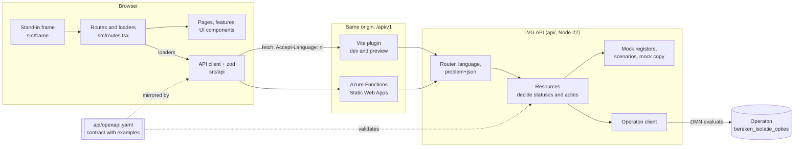

# LVG: MijnOverheid Wonen

The "Wonen" content pages that Logius will publish in MijnOverheid. A homeowner sees their
properties with Kadaster, WOZ and energy label data, and gets roof insulation advice from the
Operaton decision `bereken_isolatie_opties`, followed by a consent step to share data with a
contractor.

LVG is a **sandbox**: data, login and consent are mocked, and copy that the designs still mark
as a placeholder is filled with mock content. `main` is the stable release, not a production
system. The port to the MijnOverheid codebase (Next.js, Nx, `@mijnoverheid/ui`) is #37.

## Sites

| Site                               | Source                                    | Deployed by                        |
| ---------------------------------- | ----------------------------------------- | ---------------------------------- |
| https://acc.lvg.open-regels.nl     | `acc`                                     | `azure-lvg-acc.yml`                |
| https://lvg.open-regels.nl         | `main`                                    | `azure-lvg-stable.yml`             |
| https://toestemming.open-regels.nl | `main`, `docs/Wireframes` as static files | `azure-toestemming-wireframes.yml` |

Each site has its own social card for link previews (the acceptance card is marked); the
source is in `docs/social/`, and `render-cards.py` there re-exports the cards to `public/`.

The band of the stand-in MijnOverheid frame shows which site and build you are viewing, for
example `acc.lvg.open-regels.nl · build c80d7d7 · #17`. A local build shows `local build`.

## How it works

The pages present what the LVG API decides: statuses, final amounts and the actions a page may
offer (`acties`). The API is the only part that talks to the sources and to Operaton, as
Logius's conditions require (no business logic in the front-end).



- **Contract first.** `api/openapi.yaml` (OpenAPI 3.0.3, linted against the Dutch API Design
  Rules) is written before the code. Every response has an example; the API tests validate
  the handlers against it, and the front-end's zod schemas and test fixtures come from it.
- **Layers.** Only `src/api/` fetches, and it validates every response. Pages get their data
  from route loaders; features and UI components take data and copy as props.
- **Strict CSP.** Both sites send `style-src 'self'` without `unsafe-inline` or `unsafe-eval`.
  LUX's run-time style injection is moved into a stylesheet at build time
  (`vite/luxCssPlugin.js`), and `vite preview` sends the same headers
  (`vite/swaHeadersPlugin.js`), so a violation shows up locally first.
- **Stand-in frame.** `src/frame/` imitates the MijnOverheid frame around the content and is
  not part of the delivery; content never imports from it. `?kader=uit` hides it, and a build
  with `VITE_FRAME=off` leaves it out.

## Stack

| Part        | Choice                                                                          |
| ----------- | ------------------------------------------------------------------------------- |
| Front-end   | React 18, React Router 7 (data mode), strict TypeScript, Vite 8                 |
| Design      | LUX (`@lux-design-system/components-react`, tokens), SCSS modules on `--lux-*`  |
| Validation  | zod schemas mirroring the contract                                              |
| API         | Node 22, Azure Functions v4 as Static Web Apps managed functions                |
| Decision    | Operaton, DMN `bereken_isolatie_opties` (source in `dmn/`)                      |
| Tests       | Vitest with Testing Library, jsdom and axe; Playwright with axe and a CSP check |
| Code checks | ESLint (type-checked, zero warnings), Prettier, Spectral (API Design Rules)     |

The Rijksoverheid font is not included (it is not published with LUX); the pages fall back to
Arial until #43.

## Repository

| Path                | Contents                                                            |
| ------------------- | ------------------------------------------------------------------- |
| `src/api/`          | API client, zod schemas, one function per operation, action routes  |
| `src/pages/`        | One page per route, with its loader                                 |
| `src/features/`     | Page sections                                                       |
| `src/components/`   | UI components on LUX (cards, data list, breadcrumb, info, alert …)  |
| `src/frame/`        | The stand-in MijnOverheid frame                                     |
| `e2e/`              | Playwright walkthroughs                                             |
| `api/`              | LVG API: contract, router, resources, mock sources, Operaton client |
| `dmn/`              | The decision's source, deployed to the local Operaton               |
| `vite/`             | Vite plugins: the API in dev and preview, LUX CSS, preview headers  |
| `docs/superpowers/` | Specs and plans; the current one is `2026-11-19-mijnoverheid-wonen` |
| `docs/runbook.md`   | The iteration loop, local setup, scenarios and review               |

The old single-page dashboard (`src/hooks/`, `src/services/` and the `.jsx` components) is no
longer in the bundle and is removed in Part 3 of the plan.

## Prerequisites

- Node.js in the version named in `.nvmrc`, with npm 11.10 or newer.
- A local Operaton on `http://localhost:8081` with `bereken_isolatie_opties` deployed, for the
  roof insulation advice during development. Without it the advice shows as unavailable.

## Getting started

```bash
npm ci
npm ci --prefix api
npx playwright install chromium   # once, for the walkthroughs
bash scripts/deploy-dmn-local.sh
npm run dev
```

`npm run dev` first checks that both installs match their lockfiles. If they do not, it stops
and asks for `npm ci`. The pages run on http://localhost:5173/nl/wonen, and the LVG API on
http://localhost:5173/api/v1/. Changes in `api/` need a dev server restart.

### Settings

The API's settings stay on the server and never reach the browser. Override the defaults in
`.env.local`:

| Variable            | Default (dev server only)           | Purpose                                 |
| ------------------- | ----------------------------------- | --------------------------------------- |
| `OPERATON_BASE_URL` | `http://localhost:8081/engine-rest` | The Operaton the API calls              |
| `OPERATON_USER`     | `demo`, for the local engine only   | Login for the local Operaton            |
| `OPERATON_PASSWORD` | `demo`, for the local engine only   | Login for the local Operaton            |
| `LVG_SCENARIOS`     | `on`                                | Lets `X-LVG-Scenario` choose a scenario |

To use the public Operaton, set `OPERATON_BASE_URL=https://operaton.open-regels.nl/engine-rest`;
it gets no login. On Azure, `OPERATON_BASE_URL` is an app setting and has no default.

### Scenarios

The API simulates a citizen with no property, one property or three. The default is one
property, so Wonen leads straight to it. Choose another with the scenario switch in the band of
the frame; the choice holds for the browser tab. See `docs/runbook.md`.

## Scripts

| Script                       | Purpose                                                       |
| ---------------------------- | ------------------------------------------------------------- |
| `npm run dev`                | Dependency check, then the dev server with the API            |
| `npm run build`              | Production build in `dist/`                                   |
| `npm run preview`            | Serve the build with the API and the deployed headers         |
| `npm test`                   | Front-end tests (Vitest, jsdom, axe)                          |
| `npm run test:api`           | API tests, responses validated against the contract           |
| `npm run test:e2e`           | Build, then the Playwright walkthroughs (desktop and mobile)  |
| `npm run lint`               | ESLint, zero warnings                                         |
| `npm run typecheck`          | TypeScript, strict (pages and walkthroughs)                   |
| `npm run lint:contract`      | The contract against the API Design Rules                     |
| `npm run check-format`       | Check formatting (`npm run format` fixes it)                  |
| `npm run check-bundle`       | No Operaton address or local login in `dist/`                 |
| `npm run deps:check`         | Check that both installs match their lockfiles                |
| `npm run check-previews`     | Find preview environments left behind by closed pull requests |
| `npm run check-supply-chain` | Check pinned actions against `SECURITY-PIPELINE.md`           |
| `npm run audit:signatures`   | Verify npm registry signatures                                |

Git hooks run lint-staged on commit, and on push the dependency check, lint, type-check, both
test suites, the contract lint and the format check.

## How changes reach the sites

1. Branch from `acc` and open a pull request into `acc`. Checks run, including the walkthroughs
   on the build that gets deployed, and a preview is deployed.
2. After merging, `acc.lvg.open-regels.nl` is updated.
3. A pull request from `acc` to `main` promotes the work. After merging, the stable release is
   updated.

`acc` and `main` accept changes only through pull requests, with required checks. Renovate
proposes dependency updates. See [SECURITY-PIPELINE.md](SECURITY-PIPELINE.md) for the checks,
pinning, the content security policy, rulesets and accepted Semgrep findings.

## Licence

[EUPL 1.2](LICENSE)
